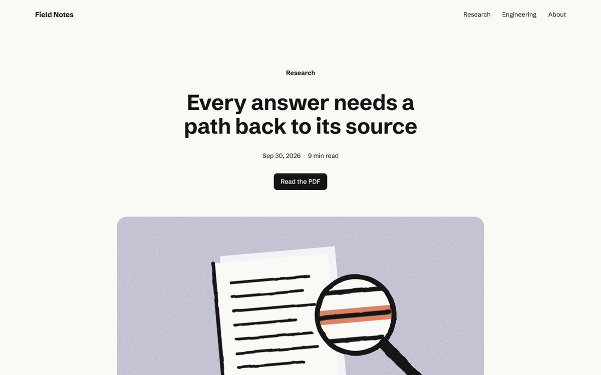
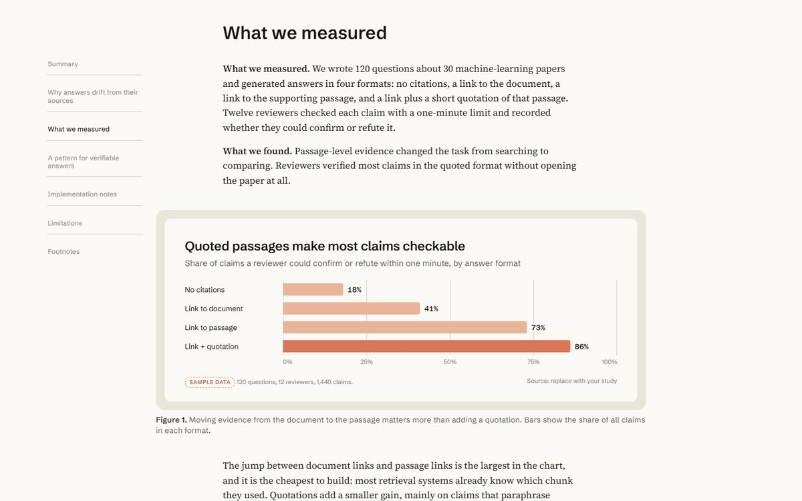
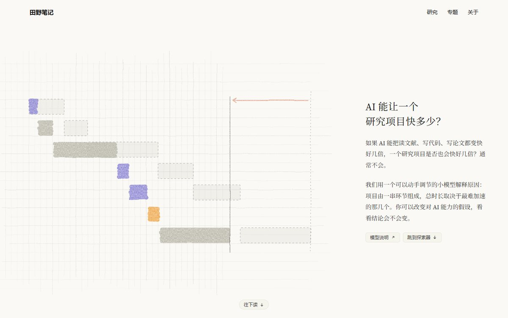
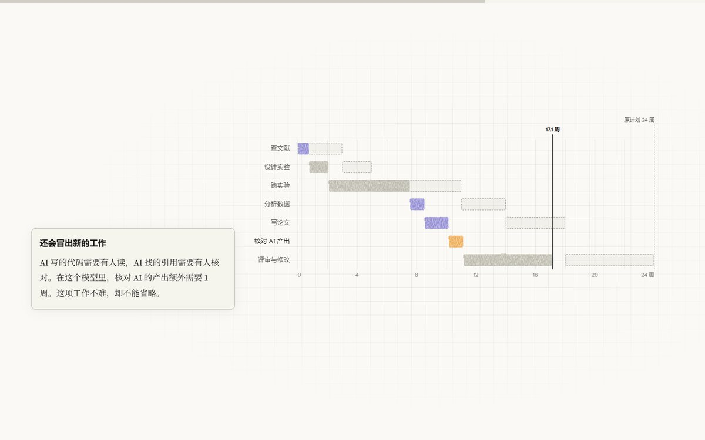
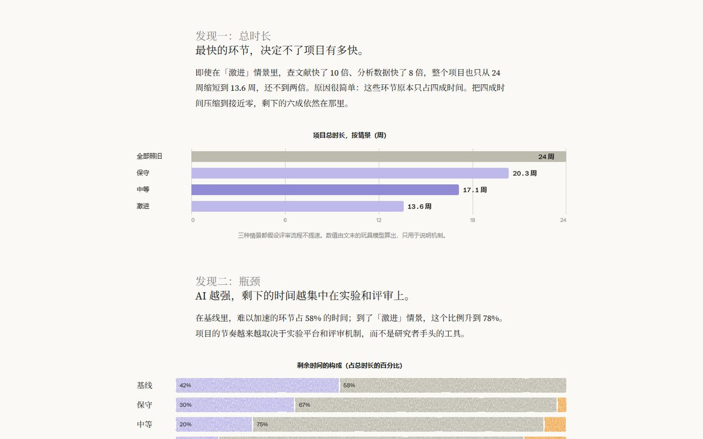
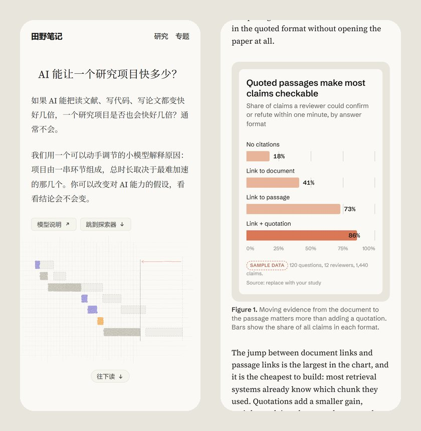

# anthropic-blog

**An agent skill for writing and building long-form explanatory articles in the editorial style of
anthropic.com research, engineering and Institute posts.**

Warm paper, a serif reading column, sans-serif structure, figures in frames, footnotes, and — when the
topic calls for it — scrollytelling and interactive explorers. Works with Claude Code, Codex, Gemini CLI,
GitHub Copilot, Cursor, OpenCode, pi and any other agent that reads [Agent Skills](https://agentskills.io).
English and Chinese are both first-class.

[中文说明](README.zh-CN.md)

> Unofficial. Not affiliated with, endorsed by or sponsored by Anthropic. The skill contains no Anthropic
> fonts, logos, illustrations or text; it teaches an editorial approach and ships open-licensed stand-ins.



| Framed chart | Interactive explainer (Chinese) |
|---|---|
|  |  |
|  |  |

<p align="center"></p>

## What you get

- **A calibrated design system** — `assets/editorial.css`. Colours, type scale, spacing, measures and
  component styles measured from public anthropic.com posts (Sept 2026), scoped under `.editorial` so it
  drops into existing sites. Open fonts chosen by side-by-side rendering: Source Serif 4 reproduces the
  source's line breaks exactly; Schibsted Grotesk was the closest of thirteen sans faces.
- **Two templates** with realistic sample content:
  - `assets/article.html` — research / engineering post: centred header, ink-drawn hero, sticky TOC,
    summary, framed charts, process diagram, pull quote, code, table, footnotes, citation.
  - `assets/feature.html` — visual explainer (in Chinese): split hero with crayon-on-grid art, drop cap,
    sticky scrollytelling, a live explorer backed by a transparent toy model, findings, method note.
- **Guidance the agent reads on demand** — writing (`editorial.md`), design tokens and CJK rules
  (`design-system.md`), copy-paste components (`components.md`), charts and illustration recipes
  including SVG crayon/pencil/ink textures (`figures.md`), interaction and accessibility
  (`interaction.md`), and what was measured on the source site (`source-study.md`).
- **A render checker** — `scripts/check_page.py` screenshots desktop and phone widths and reports
  horizontal overflow, console errors, fonts that fell back, leftover sample data and placeholders,
  missing alt text, heading-level skips and reduced-motion behaviour.

The skill's rules are about explanation first: a concrete case before abstraction, headings that are
claims, figures whose titles state the takeaway, measured vs. inferred vs. assumed kept apart, and no
numbers invented to fill a layout. Template numbers are flagged `data-sample`, and the checker complains
until they are replaced.

## Install

The skill is a folder with a `SKILL.md`. Put it where your agent looks for skills.

**All agents that read `~/.agents/skills`** (Codex, Gemini CLI, GitHub Copilot CLI, Cursor, OpenCode, pi):

```bash
git clone https://github.com/kimio-hub/anthropic-blog ~/.agents/skills/anthropic-blog
```

**Claude Code** reads `~/.claude/skills`. Link the same folder so there is one copy to update:

```bash
# macOS / Linux
ln -s ~/.agents/skills/anthropic-blog ~/.claude/skills/anthropic-blog
```

```powershell
# Windows (no admin rights needed)
New-Item -ItemType Junction -Path "$HOME\.claude\skills\anthropic-blog" -Target "$HOME\.agents\skills\anthropic-blog"
```

Or clone straight into `~/.claude/skills/anthropic-blog` if Claude Code is your only agent.
Per-project installs work too: `.agents/skills/` or `.claude/skills/` inside a repository.

**With the skills CLI**: `npx skills add kimio-hub/anthropic-blog` and pick your agents.

**claude.ai / Claude API uploads** reject skill names containing “anthropic”. Rename the folder and the
`name:` field (for example to `editorial-blog`) before zipping and uploading.

Update later with `git -C ~/.agents/skills/anthropic-blog pull`.

## Use

Ask in your own words; the description triggers the skill. In Claude Code you can also type
`/anthropic-blog`, in Codex `$anthropic-blog`.

- “Turn `notes/eval-results.md` into an Anthropic-style research post with a summary, two charts and footnotes.”
- “Restyle our engineering blog post in the Anthropic editorial look, keep our logo and wording.”
- “Build an interactive explainer about how caching changes API latency, with a step-by-step scroll story and a slider.”
- “把这篇笔记做成 Anthropic 风格的中文长文，要有框式图表和脚注。”
- “用 Anthropic Institute 那种交互专题的形式，解释为什么团队扩张后交付没有变快。”

The agent frames the reader question, drafts the text, builds from a template, replaces every sample,
checks the page at 1440px and 390px, and reports what it verified.

To run the checker yourself:

```bash
pip install playwright && python -m playwright install chromium   # or pass --channel chrome / msedge
python ~/.agents/skills/anthropic-blog/scripts/check_page.py path/to/page.html
```

## Layout

```
anthropic-blog/
├── SKILL.md              instructions the agent loads
├── agents/openai.yaml    Codex / ChatGPT display metadata
├── assets/               editorial.css, article.html, feature.html
├── references/           design-system, components, figures, interaction, editorial, source-study
├── scripts/              check_page.py
└── docs/                 README images
```

## Notes

- Fonts load from Google Fonts in the templates. Self-host them, or use a mirror you trust, where Google
  is slow or blocked; fallbacks keep pages readable.
- Measurements come from public pages on 2026-09-30 and will drift as the site changes; see
  `references/source-study.md` for method and scope.
- "Anthropic" and "Claude" are trademarks of Anthropic, PBC, used here only to describe the style the
  skill is inspired by.

## License

[MIT](LICENSE) for the skill's code, templates and text.
