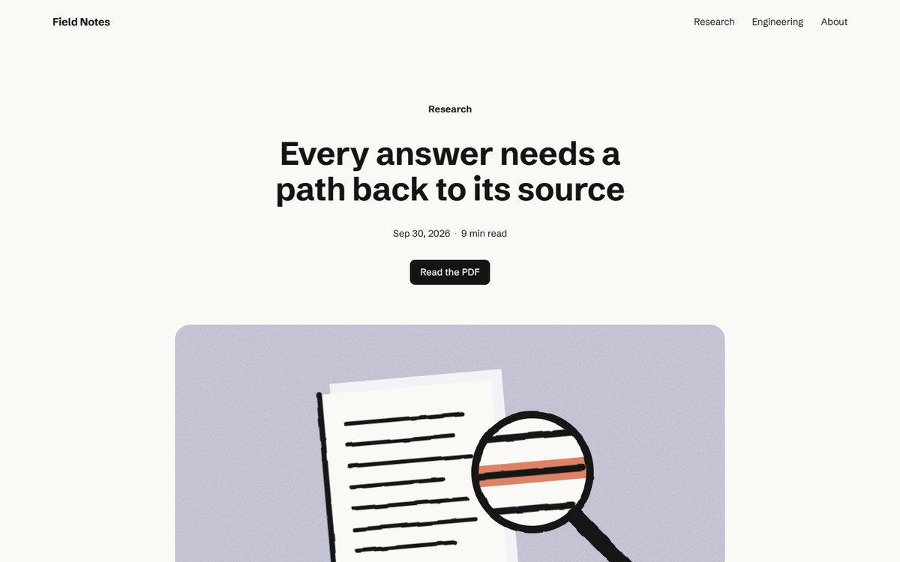
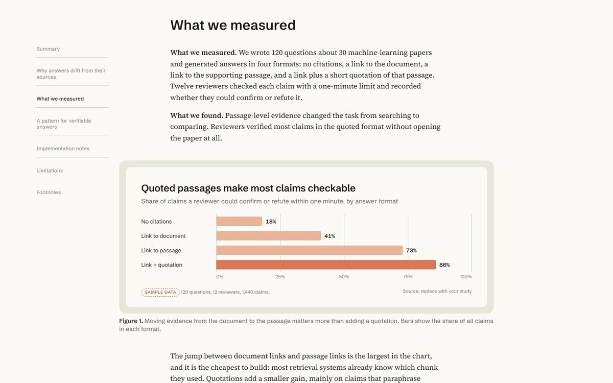
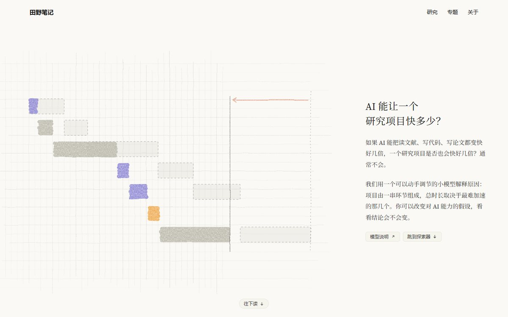
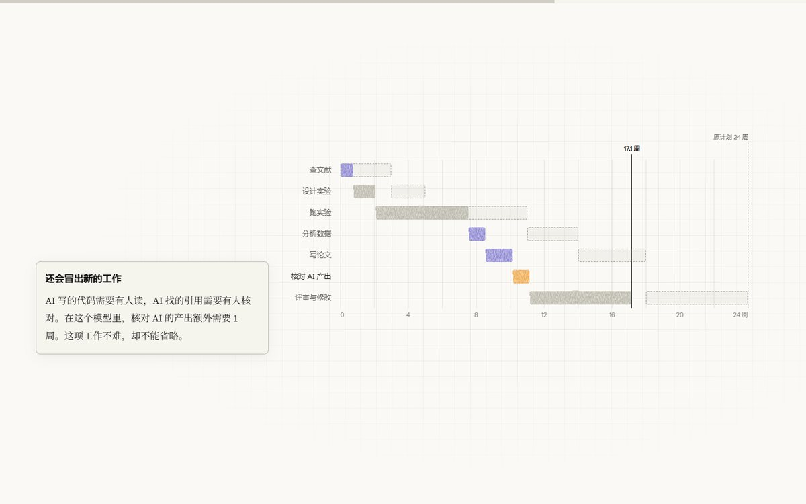
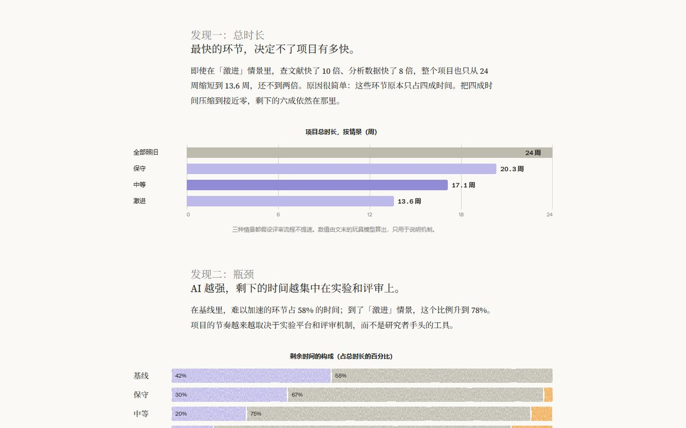
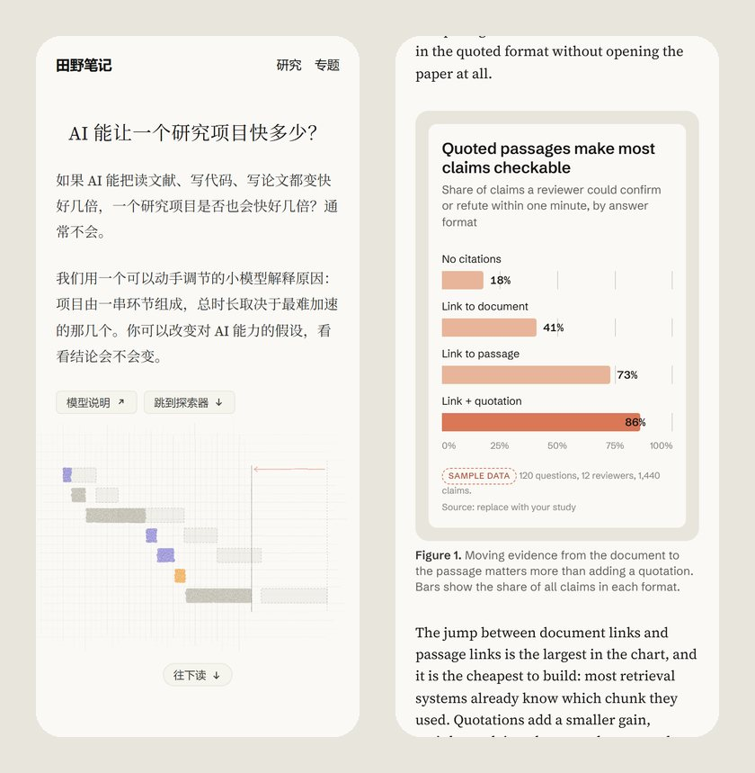

# anthropic-blog

**一个 Agent Skill：按 anthropic.com 研究、工程和 Institute 专题文章的编辑风格，写作并搭建长篇解释性文章。**

暖白纸色、衬线正文栏、无衬线结构、带框的图表、脚注，以及在题材需要时加入的滚动叙事和交互探索器。适用于
Claude Code、Codex、Gemini CLI、GitHub Copilot、Cursor、OpenCode、pi 等所有读取
[Agent Skills](https://agentskills.io) 的智能体。中文和英文都是一等公民。

[English](README.md)

> 非官方项目，与 Anthropic 无隶属、背书或赞助关系。本 skill 不包含 Anthropic 的字体、标志、插画或文字，
> 只提炼编辑方法，并使用开源授权的替代字体。



| 带框图表 | 中文交互专题 |
|---|---|
|  |  |
|  |  |

<p align="center"></p>

## 包含什么

- **校准过的设计系统** `assets/editorial.css`：颜色、字号、间距、栏宽和组件样式，数值来自对 anthropic.com
  公开文章的实测（2026 年 9 月）；所有规则都限定在 `.editorial` 之下，可以直接放进已有网站。字体经过并排渲染
  挑选：Source Serif 4 与原站正文的断行完全一致，Schibsted Grotesk 是 13 款开源无衬线字体里最接近的。
- **两个模板**，内容是写实的示例：
  - `assets/article.html`：研究 / 工程文章。居中标题、墨线插画首图、侧边目录、摘要、带框图表、流程图、
    引语、代码、表格、脚注、引用格式。
  - `assets/feature.html`：中文可视化专题。左图右文首屏（铅笔网格 + 蜡笔笔触）、首字下沉、粘性滚动叙事、
    基于透明玩具模型的实时探索器、分条“发现”、模型说明。
- **按需读取的指南**：写作（`editorial.md`）、设计 token 与中文排版规则（`design-system.md`）、可复制的组件
  代码（`components.md`）、图表选型与插画配方，含 SVG 蜡笔 / 铅笔 / 墨线质感滤镜（`figures.md`）、交互与无障碍
  （`interaction.md`）、原站实测记录（`source-study.md`）。
- **渲染检查脚本** `scripts/check_page.py`：在桌面和手机宽度截图，并报告横向溢出、控制台错误、字体回退、
  残留的示例数据和占位符、缺失的 alt、标题层级跳跃，以及减少动态效果时的表现。

这个 skill 首先要求把问题讲清楚：先给具体例子再抽象，小标题写成判断，图表标题直接说结论，区分测量、推断和假设，
不为填满版面编造数字。模板里的示例数字都标了 `data-sample`，没替换掉之前检查脚本会一直提醒。

## 安装

skill 就是一个带 `SKILL.md` 的文件夹，放到智能体读取 skill 的目录即可。

**读取 `~/.agents/skills` 的智能体**（Codex、Gemini CLI、GitHub Copilot CLI、Cursor、OpenCode、pi）：

```bash
git clone https://github.com/kimio-hub/anthropic-blog ~/.agents/skills/anthropic-blog
```

**Claude Code** 读取 `~/.claude/skills`，建议链接到同一个文件夹，只维护一份：

```bash
# macOS / Linux
ln -s ~/.agents/skills/anthropic-blog ~/.claude/skills/anthropic-blog
```

```powershell
# Windows（不需要管理员权限）
New-Item -ItemType Junction -Path "$HOME\.claude\skills\anthropic-blog" -Target "$HOME\.agents\skills\anthropic-blog"
```

只用 Claude Code 的话，也可以直接克隆到 `~/.claude/skills/anthropic-blog`。项目级安装同样可行：仓库里的
`.agents/skills/` 或 `.claude/skills/`。

**用 skills CLI**：`npx skills add kimio-hub/anthropic-blog`，然后选择要安装到哪些智能体。

**上传到 claude.ai / Claude API**：平台不接受名字里含 “anthropic” 的 skill。打包上传前，把文件夹名和
`name:` 字段改成别的名字（例如 `editorial-blog`）。

以后更新：`git -C ~/.agents/skills/anthropic-blog pull`。

## 使用

用自己的话描述需求即可触发。Claude Code 里也可以输入 `/anthropic-blog`，Codex 里输入 `$anthropic-blog`。

- “把这篇笔记做成 Anthropic 风格的中文长文，要有框式图表和脚注。”
- “用 Anthropic Institute 那种交互专题的形式，解释为什么团队扩张后交付没有变快。”
- “按 Anthropic 的编辑风格重排我们的工程博客，保留我们的 logo 和原文。”
- “Turn `notes/eval-results.md` into an Anthropic-style research post with a summary, two charts and footnotes.”

智能体会先明确读者问题，再写正文，然后基于模板搭建页面、替换所有示例内容、在 1440px 和 390px 宽度下检查页面，
最后说明验证了什么。

自己运行检查脚本：

```bash
pip install playwright && python -m playwright install chromium   # 或者加 --channel chrome / msedge 使用本机浏览器
python ~/.agents/skills/anthropic-blog/scripts/check_page.py 页面.html
```

## 注意

- 模板从 Google Fonts 加载字体。在 Google 访问慢或受限的地区（例如中国大陆），请自托管字体文件或使用可信的镜像；
  即使字体加载失败，回退字体也能保证可读。
- 实测数据来自 2026-09-30 的公开页面，原站改版后会有偏差；方法和范围见 `references/source-study.md`。
- “Anthropic” 和 “Claude” 是 Anthropic, PBC 的商标，这里仅用于说明本 skill 借鉴的风格。

## 许可

[MIT](LICENSE)。
